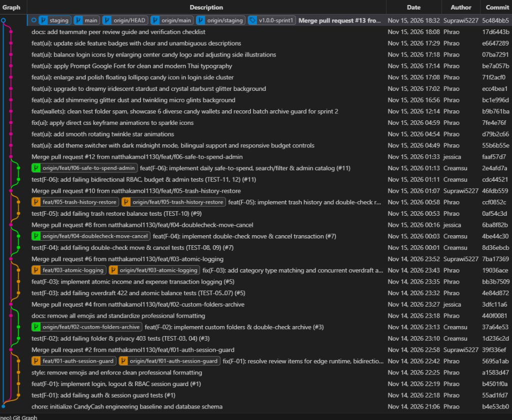
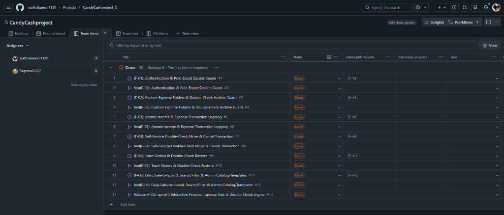

# CandyCash: Smart Personal Money & Expense Logging System
## CPE 334 Software Engineering — Deliverable 1 Project Report (Sprint 1 Release)

---

## ข้อมูลโครงงานและคณะผู้จัดทำ (Project & Team Information)

- **ชื่อโครงงาน (Project Name):** CandyCash (Smart Personal Money & Expense Logging System)
- **หลักสูตรและวิชา:** CPE 334 Software Engineering (ภาคการศึกษาที่ 1/2569)
- **การส่งมอบ:** Deliverable 1 (Engineering Baseline & Sprint 1 Release — 80 คะแนน)
- **คณะผู้จัดทำ (Development Team):**
  1. **นางสาว ณัฏฐกมล มอญปาน** | รหัสนักศึกษา: **67070505215**
     - บทบาท: **GitHub Lead / Full-Stack Developer**
     - บัญชี GitHub: `@natthakamol1130`
     - ความรับผิดชอบหลัก: ออกแบบสถาปัตยกรรมระบบ, จัดตั้ง GitHub Repository & Project Board, พัฒนาฟีเจอร์ F-01, F-03, F-05, ตรวจทานโค้ด F-02, F-04, F-06, และเปิด Release PR #13
  2. **นางสาว สุประวีณ์ สุทธิเสรีนิวัฒน์** | รหัสนักศึกษา: **67070505227**
     - บทบาท: **Code Reviewer / Full-Stack Developer**
     - บัญชี GitHub: `@suprawi5227`
     - ความรับผิดชอบหลัก: ตรวจทานโค้ด (Peer Review) F-01, F-03, F-05, พัฒนาฟีเจอร์ F-02, F-04, F-06, อนุมัติและผสาน Release PR #13 เข้าสู่สาขาหลัก main

---

## สรุปลิงก์หลักฐานการส่งมอบงานบน GitHub (Deliverable Links)

| รายการส่งมอบ | ลิงก์อ้างอิงบน GitHub | สถานะการตรวจสอบ |
| :--- | :--- | :--- |
| **GitHub Repository** | https://github.com/natthakamol1130/CandyCash | สาขาหลัก `main` และ `staging` ซิงค์ตรงกันสมบูรณ์ |
| **GitHub Project Board** | https://github.com/users/natthakamol1130/projects/8 | กระดาน `CandyCashproject` ครบทั้ง 13 รายการ อยู่ในคอลัมน์ `Done` 100% |
| **Release PR #13** | https://github.com/natthakamol1130/CandyCash/pull/13 | สถานะ `Merged` เข้าสู่ `main` โดย `@suprawi5227` |
| **Release Tag v1.0.0-sprint1** | https://github.com/natthakamol1130/CandyCash/releases/tag/v1.0.0-sprint1 | ติดป้ายกำกับเวอร์ชันและเผยแพร่ Release Notes ทางการเรียบร้อย |
| **ผลการทดสอบอัตโนมัติ (TDD)** | รันผ่าน Vitest (`npm test`) | ผ่านครบทั้ง **52/52 การทดสอบ** (`TEST-01` ถึง `TEST-12`) |
| **ผลการตรวจ Typecheck** | รันผ่าน `npx tsc --noEmit` | **0 Error** (ไม่มีข้อผิดพลาดทางชนิดข้อมูล) |

---

## 1. ภาพรวมของระบบและสถาปัตยกรรม (Part A: System Overview & Architecture)

### 1.1 วัตถุประสงค์และรูปแบบของระบบ
**CandyCash** เป็นเว็บแอปพลิเคชันสมุดจดบันทึกรายรับ-รายจ่ายส่วนตัวอัจฉริยะ ออกแบบภายใต้แนวคิด "ความน่ารักของโทนพาสเทล ผสานความรัดกุมระดับระบบการเงิน (Delightful Aesthetics with Financial-Grade Integrity)"
- **ไม่ผูกกับธนาคารจริง:** ป้องกันความเสี่ยงทางไซเบอร์ โดยให้ผู้ใช้สร้างโฟลเดอร์จำลอง (Virtual Money Folders) เพื่อจดบันทึก บริหารเงินสด บัญชีธนาคาร กระเป๋า e-Wallet และกระปุกเงินเก็บด้วยตนเอง
- **ระบบยืนยันสองชั้น (Double-Check Engine):** มุ่งเน้นการป้องกันความผิดพลาดจากพฤติกรรมมนุษย์ (Human Error Guard) ทุกการย้ายเงิน ขอยกเลิกรายการ กู้คืนจากถังขยะ หรือเก็บโฟลเดอร์เข้ากรุ จะต้องผ่านหน้าต่าง Double-Check สรุปยอดเงินก่อน-หลังการทำรายการ พร้อมส่งค่า `confirmed: true` เสมอ

### 1.2 การแบ่งบทบาทผู้ใช้งาน (Bidirectional Role-Based Access Control)
ระบบแบ่งสิทธิ์ผู้ใช้งานออกเป็น 2 กลุ่มอย่างเด็ดขาด:
1. **`USER` (Personal Account Owner):**
   - มีกรรมสิทธิ์เต็มที่ในการสร้างและจัดการโฟลเดอร์ส่วนตัว จดรายรับ-รายจ่าย ย้ายรายการ และกู้คืนรายการได้ด้วยตนเอง
   - ไม่สามารถเข้าถึงคอนโซลหรือเรียก API ฝั่งแอดมิน (`/api/admin/*`, `POST /api/categories`, `POST /api/budget-templates`) ได้ รับผลลัพธ์ `403 FORBIDDEN`
2. **`ADMIN` (System & Catalog Administrator):**
   - ดูแลหมวดหมู่มาตรฐานกลางของระบบ (`System Categories`) และสร้างสูตรจัดงบประมาณแนะนำ (`Starter Budget Templates`)
   - **นโยบายความเป็นส่วนตัว 100% (100% Privacy Guard):** บัญชี ADMIN ถูกปิดกั้นสิทธิ์อย่างเข้มงวด ไม่สามารถเปิดดูหรือจัดการโฟลเดอร์หรือรายการเงินส่วนตัวของ USER ได้โดยเด็ดขาด (`403 FORBIDDEN`)

### 1.3 สถาปัตยกรรมเทคโนโลยี (Technology Stack)
- **Frontend Framework:** Next.js 14 (App Router), React 18, Tailwind CSS, TypeScript
- **Design System:** Custom Candy Palette, Glassmorphism Cards, Lucide Icons, Custom Animated SVGs, Google Font Prompt
- **Backend & Database:** Next.js Route Handlers, Prisma ORM 5, SQLite (Local Dev) / PostgreSQL Ready, bcryptjs
- **Authentication & Security:** JSON Web Token (JWT) ลงนามด้วย SHA-256 จัดเก็บใน `HttpOnly`, `SameSite=Lax`, `Secure` Cookie
- **Testing Engine:** Vitest 2.1, Node Test Environment

### 1.4 โครงสร้างฐานข้อมูล (Database Schema & ER Diagram)
1. `User`: เก็บบัญชีผู้ใช้ (`id`, `email`, `passwordHash`, `fullName`, `role`)
2. `Wallet`: เก็บโฟลเดอร์เงินจำลอง (`id`, `name`, `type`, `color`, `icon`, `currentBalance`, `isArchived`, `userId`)
3. `Category`: เก็บหมวดหมู่ค่าใช้จ่าย (`id`, `name`, `type`, `icon`, `isSystem`, `createdById`)
4. `Transaction`: เก็บรายการเงิน (`id`, `amount`, `type`, `status`, `walletId`, `categoryId`, `createdById`, `note`, `timestamp`)
5. `BudgetTarget`: เก็บการตั้งงบประมาณรายเดือน (`id`, `month`, `year`, `targetBudget`, `userId`)
6. `StarterTemplate`: เก็บสูตรจัดงบของแอดมิน (`id`, `name`, `description`, `suggestedBudget`, `createdById`)

---

## 2. รายละเอียดครบถ้วนทั้ง 12 ฟีเจอร์ของระบบ (Part B: 12 Golden Features Breakdown)

CandyCash ถูกออกแบบให้มีฟังก์ชันการทำงานรวมทั้งสิ้น 12 ฟีเจอร์หลัก เรียงลำดับตาม 3 Sprint ไม่ข้ามข้อ โดยใน Deliverable 1 นี้ ฟีเจอร์ F-01 ถึง F-06 ได้รับการพัฒนาเสร็จสมบูรณ์ 100%

### 2.1 ฟีเจอร์ Sprint 1 (`F-01` ถึง `F-06`) — เสร็จสมบูรณ์และเปิดใช้งาน 100%

#### `F-01`: Authentication & Role-Based Session Guard
- **เป้าหมาย:** ระบบลงชื่อเข้าใช้และออกจากระบบ พร้อมตรวจจับเซสชันและกั้นสิทธิ์สองทาง
- **การทำงาน:**
  - `POST /api/auth/login`: ตรวจสอบรหัสผ่านผ่าน bcrypt และออก JWT Cookie ชื่อ `candycash_session`
  - `POST /api/auth/logout`: ล้าง Cookie เพื่อตัดการเชื่อมต่ออย่างปลอดภัย
  - `GET /api/auth/me`: ส่งคืนข้อมูลโปรไฟล์ของผู้ใช้ที่ล็อกอินอยู่
  - Route Guard & Middleware: กั้นการเข้าถึงหน้า Dashboard โดยไม่มีเซสชัน (`401 Unauthorized`) และกั้น USER ไม่ให้เข้าถึงเส้นทาง Admin (`403 Forbidden`)
- **ความสอดคล้อง:** `FR-01`, `BR-03`, `NFR-01`, `NFR-03` | รหัสทดสอบ: `TEST-01`, `TEST-02`

#### `F-02`: Custom Expense Folders & Double-Check Archive Guard
- **เป้าหมาย:** ระบบสร้างโฟลเดอร์เงินจำลอง ปรับแต่งโทนสี/ไอคอน และคำนวณยอดเงินรวมสุทธิ
- **การทำงาน:**
  - `POST /api/wallets`: สร้างโฟลเดอร์ใหม่ กำหนดประเภทได้ 4 แบบ (`CASH`, `BANK`, `EWALLET`, `POCKET`) เลือกสีลูกกวาด 6 สี และไอคอน 6 ชนิด
  - `GET /api/wallets`: เรียกดูเฉพาะโฟลเดอร์ที่ยังใช้งานอยู่ (`isArchived: false`) ของผู้ใช้นั้นๆ
  - `PATCH /api/wallets/:id/archive`: เก็บโฟลเดอร์เข้ากรุผ่านการยืนยัน Double-Check โดยซ่อนออกจากรายการหลักแต่คงประวัติรายการเงินไว้ครบถ้วน
  - คำนวณยอดรวมสุทธิ (`Total Net Balance`) แบบ Real-time
- **ความสอดคล้อง:** `FR-02`, `BR-01`, `BR-06` | รหัสทดสอบ: `TEST-03`, `TEST-04`

#### `F-03`: Atomic Income & Expense Transaction Logging
- **เป้าหมาย:** ระบบจดบันทึกรายรับและรายจ่าย พร้อมกลไกความปลอดภัยด้านยอดเงินแบบ Atomic
- **การทำงาน:**
  - `POST /api/transactions`: บันทึกรายการเงินเข้าโฟลเดอร์ที่เลือก
  - หมวดหมู่ต้องตรงประเภท (`BR-01`): บันทึก `INCOME` ต้องใช้หมวดหมู่ประเภท `INCOME`, บันทึก `EXPENSE` ต้องใช้หมวดหมู่ประเภท `EXPENSE` มิฉะนั้นส่งกลับ `422 CATEGORY_TYPE_MISMATCH`
  - กลไกป้องกันเงินติดลบ (`BR-02`): ตรวจสอบยอดเงินคงเหลือในโฟลเดอร์ หากรายจ่ายมากกว่ายอดเงินคงเหลือ ระบบจะปฏิเสธด้วย `422 INSUFFICIENT_WALLET_BALANCE`
  - ใช้ Prisma Interactive Transaction ควบคุมการตัดเงินและบันทึกลงฐานข้อมูลพร้อมกัน ป้องกันปัญหา Race Condition
- **ความสอดคล้อง:** `FR-03`, `BR-01`, `BR-02`, `NFR-02` | รหัสทดสอบ: `TEST-05`, `TEST-06`, `TEST-07`

#### `F-04`: Self-Service Double-Check Move & Cancel Transaction
- **เป้าหมาย:** ระบบจัดการรายการด้วยตนเองผ่านหน้าต่างยืนยันสองชั้น
- **การทำงาน:**
  - `POST /api/transactions/:id/cancel`: ขอยกเลิกรายการ (`POSTED -> CANCELED`) ด้วยตนเองทันที โดยไม่ต้องพิมพ์เหตุผลและไม่ต้องรอแอดมิน
  - `POST /api/transactions/:id/move`: ย้ายรายการข้ามระหว่างโฟลเดอร์ 2 ใบ
  - ตรวจสอบยอดเงินทั้งสองฝั่ง (`BR-04`): หากย้ายรายจ่าย โฟลเดอร์ปลายทางต้องมีเงินพอให้ตัด (`422 INSUFFICIENT_TARGET_BALANCE`), หากย้ายรายรับ โฟลเดอร์ต้นทางต้องมีเงินพอให้หักออก (`422 INSUFFICIENT_SOURCE_BALANCE`)
  - ทุกคำขอต้องส่งแฟล็ก `confirmed: true` มิฉะนั้นจะปฏิเสธด้วย `400 CONFIRMATION_REQUIRED`
- **ความสอดคล้อง:** `FR-04`, `BR-04`, `BR-05`, `NFR-02` | รหัสทดสอบ: `TEST-08`, `TEST-09`

#### `F-05`: Trash History & Double-Check Restore
- **เป้าหมาย:** หน้าต่างถังขยะและประวัติรายการที่ยกเลิก พร้อมระบบกู้คืนข้อมูล
- **การทำงาน:**
  - `GET /api/trash`: แสดงรายการที่ถูกยกเลิก (`CANCELED`) พร้อมแสดงตัวหนังสือขีดฆ่า (Strikethrough) วันเวลาที่ยกเลิก และโฟลเดอร์ต้นทาง
  - `POST /api/transactions/:id/restore`: กู้คืนรายการกลับมาเป็น `POSTED`
  - ตรวจสอบยอดเงินก่อนกู้คืน (`BR-05`): หากกู้คืนรายการรายจ่าย โฟลเดอร์ต้องมียอดคงเหลือเพียงพอให้หักเงินใหม่ มิฉะนั้นจะส่งกลับ `422 INSUFFICIENT_BALANCE_TO_RESTORE`
  - ปฏิเสธการกู้คืนหากโฟลเดอร์ต้นทางถูกจัดเก็บเข้ากรุไปแล้ว (`400 WALLET_ARCHIVED`)
- **ความสอดคล้อง:** `FR-05`, `BR-05`, `NFR-02` | รหัสทดสอบ: `TEST-10`

#### `F-06`: Daily Safe-to-Spend, Search/Filter & Admin Catalog/Templates
- **เป้าหมาย:** ระบบคำนวณงบที่ใช้ได้ต่อวัน กราฟสัดส่วนรายจ่าย ช่องค้นหา และคอนโซลแอดมิน
- **การทำงาน:**
  - `GET / PATCH /api/budget`: ตั้งเป้าหมายงบประมาณรายเดือน และคำนวณ `Daily Safe-to-Spend = (เป้าหมายงบ - รายจ่ายที่ใช้ไปจริง) / จำนวนวันที่เหลือในเดือน`
  - แสดงแถบความคืบหน้าการใช้งบ และแสดงสัดส่วนรายจ่ายตามหมวดหมู่ (Monthly Expense Breakdown)
  - ช่องค้นหาและกรองรายการตามประเภท ข้อความบันทึกช่วยจำ และโฟลเดอร์
  - คอนโซลแอดมิน: `POST /api/categories` และ `POST /api/budget-templates` สำหรับจัดการข้อมูลกลาง พร้อมระบบกั้นสิทธิ์แอดมินไม่ให้เห็นเงินผู้ใช้ (`BR-03: 403 FORBIDDEN`)
- **ความสอดคล้อง:** `FR-06`, `BR-03`, `NFR-01` | รหัสทดสอบ: `TEST-11`, `TEST-12`

---

### 2.2 ฟีเจอร์ Sprint 2 (`F-07` ถึง `F-09`) — แผนงานระยะถัดไป (Deliverable 2)

- **`F-07: Category Budget Envelopes & Over-Budget Alert`**
  - จัดงบประมาณแยกย่อยตามซองหมวดหมู่ (เช่น ค่าอาหาร, ค่าเดินทาง, ค่าบันเทิง)
  - แถบสีสถานะอัตโนมัติ 3 ระดับ (เขียว = ปกติ, เหลือง = ใกล้เต็มงบ, แดง = เกินงบ)
  - หน้าต่างแจ้งเตือนแบบ Double-Check ทันทีเมื่อผู้ใช้กำลังจะบันทึกรายจ่ายที่ทำให้งบหมวดหมู่นั้นทะลุเป้าหมาย
- **`F-08: Atomic Inter-Wallet Transfer`**
  - โอนย้ายเงินข้ามระหว่างโฟลเดอร์ 2 ใบของตนเองแบบ Atomic (หักต้นทางและบวกปลายทางในธุรกรรมเดียว)
  - กฎธุรกิจ `BR-07`: การโอนเงินข้ามโฟลเดอร์จะไม่ถูกนับเป็นรายจ่ายสิ้นเปลือง (`EXPENSE`) ในกราฟสัดส่วนรายจ่าย
- **`F-09: Savings Goal Jars, PIN Spending Lock & Batch Archive`**
  - สร้างกระปุกออมเงินตามเป้าหมาย (Savings Goal) พร้อมแถบแสดงเปอร์เซ็นต์ความสำเร็จและระบบทำนายวันที่คาดว่าจะเก็บเงินครบ
  - กฎธุรกิจ `BR-09 (PIN Spending Lock Guard)`: ระบบตั้งรหัส PIN 4 หลักล็อกโฟลเดอร์ เพื่อป้องกันการเผลอดึงเงินเก็บไปใช้จ่ายฟุ่มเฟือย
  - กฎธุรกิจ `BR-10 (Batch Archive Double-Check Guard)`: ระบบเลือกโฟลเดอร์พร้อมกันหลายใบเพื่อจัดเก็บเข้ากรุ พร้อมหน้าต่าง Double-Check ทบทวนรายชื่อทุกโฟลเดอร์ (Itemized Summary) และยอดเงินคงเหลือรวมก่อนกดยืนยัน

---

### 2.3 ฟีเจอร์ Sprint 3 (`F-10` ถึง `F-12`) — แผนงานระยะสุดท้าย (Final Release)

- **`F-10: Recurring Bills & Monthly Due Reminder`**
  - ระบบตั้งรายการค่าใช้จ่ายประจำเดือนล่วงหน้า (เช่น ค่าเช่าห้อง, ค่าสมาชิก Netflix, ค่าน้ำ/ค่าไฟ)
  - ระบบแจ้งเตือนล่วงหน้าเมื่อใกล้ถึงวันครบกำหนดชำระเงินในแต่ละเดือน
- **`F-11: Financial Analytics Dashboard & CSV Export`**
  - แดชบอร์ดกราฟแท่งและกราฟเส้นวิเคราะห์กระแสเงินสดรายวันและรายสัปดาห์ เปรียบเทียบกับเดือนที่ผ่านมา
  - ปุ่มส่งออกข้อมูลรายการเดินบัญชีทั้งหมดออกเป็นไฟล์ `.csv` สำหรับนำไปใช้ในโปรแกรม Spreadsheet
- **`F-12: Fiscal Month-End Closing Lock & Admin Unlock`**
  - กฎธุรกิจ `BR-08 (Closed Fiscal Period Immutability)`: ระบบล็อกงวดบัญชีเมื่อสิ้นสุดเดือน (`CLOSED`) เพื่อป้องกันการเผลอแก้ไขหรือลบรายการย้อนหลัง
  - ระบบยื่นคำร้องขอให้ผู้ดูแลระบบ (`ADMIN`) ช่วยปลดล็อกงวดบัญชีเมื่อมีเหตุจำเป็นต้องแก้ไขรายการ

---

## 3. กฎธุรกิจและความปลอดภัยของข้อมูล (Part C: Business Rules BR-01 ถึง BR-10)

| รหัสกฎ | ชื่อกฎธุรกิจ | คำอธิบายและมาตรการป้องกันการทำงานผิดพลาด | รหัส HTTP |
| :--- | :--- | :--- | :--- |
| **`BR-01`** | Monetary Precision & Category Match | ยอดเงินต้องมากกว่า 0.00 และประเภทธุรกรรมต้องตรงกับประเภทหมวดหมู่ (`INCOME` กับ `INCOME`, `EXPENSE` กับ `EXPENSE`) | `422 Unprocessable Entity` |
| **`BR-02`** | Strict Zero Overdraft Guard | ห้ามบันทึกรายจ่ายเกินยอดเงินคงเหลือในโฟลเดอร์อย่างเด็ดขาด โดยตรวจสอบและอัปเดตยอดเงินแบบ Atomic Concurrency | `422 Unprocessable Entity` |
| **`BR-03`** | Bidirectional RBAC & 100% Privacy | USER เห็นเฉพาะโฟลเดอร์ของตนเอง และ ADMIN ถูกบล็อกไม่ให้เปิดดูโฟลเดอร์หรือรายการเงินส่วนตัวของ USER | `403 Forbidden` |
| **`BR-04`** | Double-Check Move Balance Sufficiency | การย้ายรายการข้ามโฟลเดอร์ต้องส่ง `confirmed: true` และตรวจสอบว่าโฟลเดอร์ทั้งสองฝั่งมียอดเงินเพียงพอ ไม่ให้ติดลบ | `400 Bad Request / 422` |
| **`BR-05`** | Double-Check Cancel & Trash Restore | ยกเลิกรายการหรือกู้คืนจากถังขยะต้องส่ง `confirmed: true` และห้ามกู้คืนรายการรายจ่ายหากเงินในโฟลเดอร์ไม่พอตัด | `409 Conflict / 422` |
| **`BR-06`** | Double-Check Folder Archive Protection | โฟลเดอร์ที่มีประวัติรายการเงินอยู่ ห้ามลบแบบ Hard Delete ต้องใช้การจัดเก็บเข้ากรุ (`Archive`) เพื่อคงประวัติบัญชีไว้ | `400 Bad Request` |
| **`BR-07`** | Savings & Transfer Separation | การโอนเงินข้ามโฟลเดอร์และการหยอดกระปุกออมเงิน จะไม่นับรวมเป็นรายจ่ายสิ้นเปลืองในงบประมาณประจำเดือน | N/A (Sprint 2 Logic) |
| **`BR-08`** | Closed Fiscal Period Immutability | ข้อมูลในเดือนที่ถูกปิดงวดบัญชีแล้ว ห้ามเพิ่ม ย้าย หรือกู้คืนรายการ เพื่อรักษาความถูกต้องตามหลักการทำบัญชี | `422 Period Closed` |
| **`BR-09`** | Folder PIN Spending Lock Guard | โฟลเดอร์ที่ตั้งค่าล็อกด้วยรหัส PIN จะไม่อนุญาตให้สร้างรายจ่ายหรือโอนเงินออกจนกว่าจะใส่รหัส PIN ถูกต้อง | `403 PIN Required` |
| **`BR-10`** | Batch Archive Itemized Double-Check | การจัดเก็บหลายโฟลเดอร์พร้อมกัน ต้องแสดงหน้าต่างสรุปทบทวนรายชื่อทุกโฟลเดอร์และยอดเงินรวมก่อนยืนยัน | `400 Confirmation Req` |

---

## 4. หลักฐานการทดสอบ TDD และ Traceability Matrix (Part D: TDD Evidence)

### 4.1 ตารางเชื่อมโยงความต้องการและรหัสการทดสอบ (Traceability Matrix)

| ข้อกำหนด | ฟีเจอร์ที่เกี่ยวข้อง | Sprint | รหัสเงื่อนไขการยอมรับ (AC) | รหัสการทดสอบ (Test ID) | สถานะ |
| :--- | :--- | :--- | :--- | :--- | :--- |
| **FR-01** | `F-01` | Sprint 1 | `AC-01, AC-02` | `TEST-01, TEST-02` | ผ่านครบ 100% |
| **FR-02** | `F-02` | Sprint 1 | `AC-03, AC-04` | `TEST-03, TEST-04` | ผ่านครบ 100% |
| **FR-03** | `F-03` | Sprint 1 | `AC-05, AC-06, AC-07` | `TEST-05, TEST-06, TEST-07` | ผ่านครบ 100% |
| **FR-04** | `F-04` | Sprint 1 | `AC-08, AC-09` | `TEST-08, TEST-09` | ผ่านครบ 100% |
| **FR-05** | `F-05` | Sprint 1 | `AC-10` | `TEST-10` | ผ่านครบ 100% |
| **FR-06** | `F-06` | Sprint 1 | `AC-11, AC-12` | `TEST-11, TEST-12` | ผ่านครบ 100% |
| **BR-01..06** | `F-01..F-06` | Sprint 1 | `AC-01..AC-12` | `TEST-01..TEST-12` | ผ่านครบ 100% |
| **NFR-01..03**| `F-01, F-03` | Sprint 1 | Security & ACID Criteria | Integration Test Suites | ผ่านครบ 100% |

### 4.2 สรุปผลการรันชุดทดสอบอัตโนมัติ (Automated Test Execution Summary)
รันการทดสอบด้วยคำสั่ง `npm test` ผ่านเอนจิน **Vitest 2.1.9** ครบทั้ง 6 ไฟล์ทดสอบ:
- `tests/f01-auth.test.ts`: ผ่าน 9/9 การทดสอบ
- `tests/f02-wallets.test.ts`: ผ่าน 9/9 การทดสอบ
- `tests/f03-transactions.test.ts`: ผ่าน 8/8 การทดสอบ
- `tests/f04-move-cancel.test.ts`: ผ่าน 9/9 การทดสอบ
- `tests/f05-trash.test.ts`: ผ่าน 8/8 การทดสอบ
- `tests/f06-safe-to-spend-admin.test.ts`: ผ่าน 9/9 การทดสอบ
- **ยอดรวมการทดสอบทั้งหมด:** **ผ่าน 52/52 การทดสอบ (100% Success Rate, 0 Failed)** ใช้เวลาเฉลี่ย 2.37 วินาที
- **การตรวจสอบ TypeScript Compiler:** `npx tsc --noEmit` ผ่านสมบูรณ์ **0 Error**

---

## 5. ผังการทำงานบน Git และหลักฐานการ Review ร่วมกัน 2 คน (Part E: Collaboration Evidence)

เพื่อให้การทำงานในทีม 2 คนเป็นไปตามกระบวนการวิศวกรรมซอฟต์แวร์มาตรฐานสากล (Collaborative Git Flow & Code Review) สมาชิกในทีมทั้งสองได้สลับบทบาทระหว่าง **Author (ผู้พัฒนา)** และ **Reviewer (ผู้ตรวจทานโค้ด)** อย่างสมดุลในทุกฟีเจอร์

### 5.1 ภาพหลักฐานที่ 1: ผังการแตกกิ่งก้านสาขาและประวัติคอมมิตบน Git (Git Graph)
ภาพด้านล่างแสดงโครงสร้าง Git Graph ที่มีระเบียบ ประกอบด้วยสาขาหลัก `main`, สาขารวมงาน `staging`, กิ่งฟีเจอร์แยกย่อย `feat/*`, ลำดับคอมมิตแบบ TDD Red-Green-Refactor, การสลับกัน Approve และ Merge Pull Request ของทั้งสองคน จนถึงจุดตัด Release Tag `v1.0.0-sprint1` ที่คอมมิต `5c484bb`:

### 5.2 ตารางรายละเอียดการสลับบทบาทตรวจทานโค้ด (Peer Review Matrix)

| ลำดับฟีเจอร์ | กิ่งสาขา (Feature Branch) | หมายเลข PR | ผู้พัฒนา (Author) | ผู้ตรวจทาน (Reviewer) | คอมมิตทดสอบ (Red) | คอมมิตฟีเจอร์ (Green) |
| :--- | :--- | :--- | :--- | :--- | :--- | :--- |
| **`F-01`** | `feat/f01-auth-session-guard` | **PR #2** | `@natthakamol1130` | `@suprawi5227` | `55ad1fd` | `b4501f0` |
| **`F-02`** | `feat/f02-custom-folders-archive`| **PR #4** | `@suprawi5227` | `@natthakamol1130` | `1d236c2` | `37a64e5` |
| **`F-03`** | `feat/f03-atomic-logging` | **PR #6** | `@natthakamol1130` | `@suprawi5227` | `4e84d87` | `bb3b750` |
| **`F-04`** | `feat/f04-doublecheck-move-cancel`| **PR #8** | `@suprawi5227` | `@natthakamol1130` | `8d36ebc` | `4be44c3` |
| **`F-05`** | `feat/f05-trash-history-restore` | **PR #10** | `@natthakamol1130` | `@suprawi5227` | `0af54c3` | `ccf0852` |
| **`F-06`** | `feat/f06-safe-to-spend-admin` | **PR #12** | `@suprawi5227` | `@natthakamol1130` | `cdc4452` | `2e4afd7` |
| **Release** | `staging` -> `main` | **PR #13** | `@natthakamol1130` | `@suprawi5227` | N/A (Full Suite) | `5c484bb` (Merged) |

### 5.3 ภาพหลักฐานที่ 2: กระดานโครงงานบน GitHub (GitHub Project Board)
ภาพด้านล่างแสดงกระดานโครงงาน **CandyCashproject** บน GitHub Project ซึ่งทั้ง 13 รายการ (ประกอบด้วย Issues 6 ข้อ และ Pull Requests 7 ข้อ) ได้รับการย้ายเข้าสู่สถานะ **`Done`** ครบถ้วน 100% พร้อมแสดงการมอบหมายงาน (Assignees) ระหว่าง `@natthakamol1130` (7 รายการ) และ `@suprawi5227` (6 รายการ):

---

## 6. การออกแบบ UI/UX สไตล์ CandyCash Pastel & Delightful Features (Part F)

ระบบ CandyCash ได้รับการปรับปรุงส่วนติดต่อผู้ใช้ (UI/UX) ให้มีความสวยงาม โดดเด่น และตรงตามธีมของระบบ ดังนี้:
1. **ติดตั้ง Google Font "Prompt (พร้อม)":** แสดงผลภาษาไทยและอังกฤษได้อย่างกลมกลืน สระและวรรณยุกต์ไม่ซ้อนทับกัน ตัวอักษรมีความโค้งมนนุ่มนวล อ่านง่าย
2. **ระบบสลับโหมด Light / Dark Midnight:** รองรับการใช้งานทั้งกลางวันและกลางคืน จดจำการตั้งค่าผ่าน LocalStorage
3. **พื้นหลังประกายระยิบระยับ (Glitter Stardust & Crystal Starburst):** เลเยอร์ประกายกลิตเตอร์แสงออโรร่าพาสเทล พร้อมดาวหมุน 360 องศา สร้างความมีชีวิตชีวาและสะท้อนความสนุกสนานในการออมเงิน
4. **ความสมดุลของไอคอน (Balanced Icon Hierarchy):** ปรับขยายขนาดโลโก้ลูกกวาด Candy ตรงกลางการ์ดเป็น 72px (ไอคอน 46px) และจัดขนาดอมยิ้ม Lollipop กับโหลลูกกวาด Candy Jar ด้านข้างที่ 48px เพื่อให้จุดนำสายตามีความสมดุล
5. **ข้อความคำอธิบายด้านข้างที่ชัดเจนและไม่กำกวม:**
   - ฝั่งซ้าย: `คำนวณเงินใช้จ่ายต่อวัน` และ `ระบบป้องกันการจ่ายเงินเกินงบ`
   - ฝั่งขวา: `สรุปตรวจทานยอด ป้องกันบันทึกผิด` และ `แยกกระเป๋าเงินตามเป้าหมาย`
6. **ข้อมูลตัวอย่างสมจริง 6 โฟลเดอร์:** ปรับปรุงข้อมูลตั้งต้น (Seed) ให้ครอบคลุมทั้ง 4 ประเภทโฟลเดอร์ (เงินสด, ธนาคาร, e-Wallet, กระปุกเงินเก็บ) และ 6 โทนสีลูกกวาด พร้อมยอดคงเหลือรวม 54,100.00 บาท เพื่อการสาธิตระบบที่สมบูรณ์แบบ

---

## 7. บทสรุปและการเตรียมความพร้อมสำหรับ Sprint 2

การส่งมอบงานใน **Sprint 1 (Deliverable 1)** ประสบความสำเร็จตามเป้าหมายของวิชา CPE 334 ครบถ้วนทุกข้อกำหนด:
- พัฒนาฟีเจอร์หลักครบ 6 รายการ (`F-01` ถึง `F-06`) ไม่มีข้อตกหล่น
- มีหลักฐาน TDD Red-Green และผ่านการทดสอบอัตโนมัติครบ **52/52 ข้อ**
- มีกระบวนการ Review สลับคู่ทำ 2 คน และมีผัง Git Graph ที่สวยงาม ถูกต้องตามหลักการทำ Branching
- มีกระดาน Project Board ที่อัปเดตสถานะครบ 100%
- สาขา `staging` และ `main` อยู่ในสถานะล่าสุดตรงกัน พร้อมสำหรับการแตกกิ่งพัฒนาฟีเจอร์ `F-07` ถึง `F-09` ใน Sprint 2 ทันที
