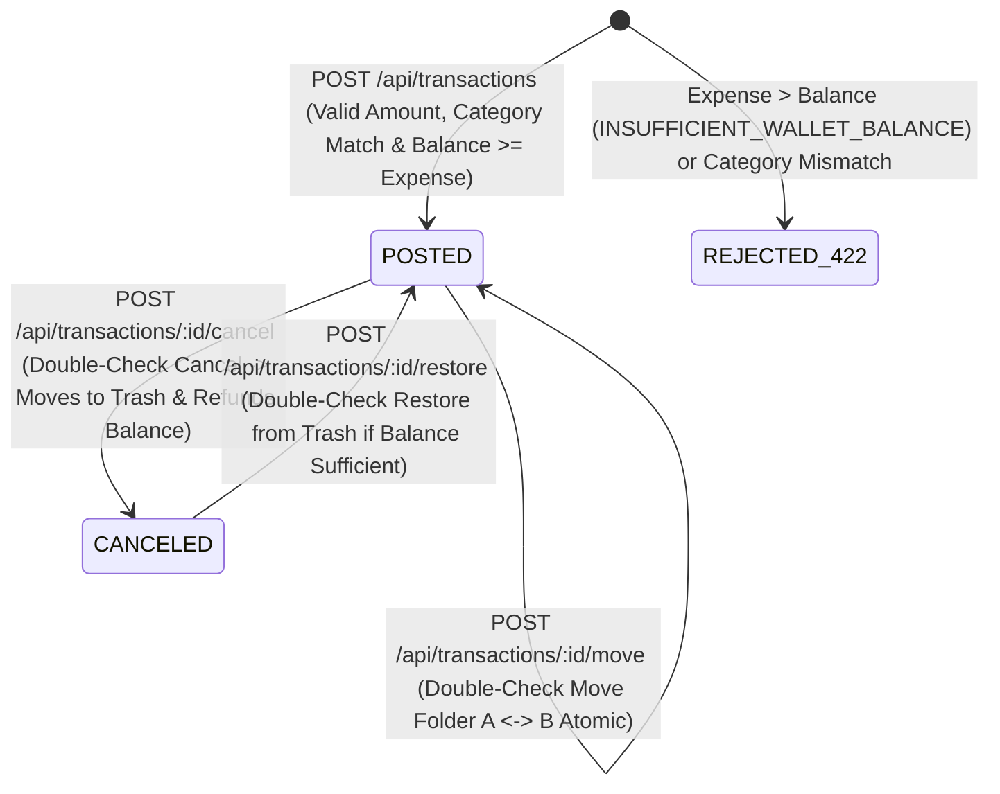

# Part E & F: Sprint 1 Engineering Contracts, AC, STS & Alternating Issue/PR Workflow — CandyCash (`docs/sprints/sprint-1/contracts.md`)

## 1. Engineering Contract Version History
| Version | Date | Author / Reviewer | Summary of Specification Changes & Justification |
| :--- | :--- | :--- | :--- |
| `v1.0` | 2026-11-01 | Both Team Members | **Initial Baseline Contract:** กำหนดสัญญาเริ่มต้นของระบบยืนยันตัวตน กระเป๋าเงิน และการบันทึกธุรกรรม |
| `v1.2` | 2026-11-02 | Both Team Members | **USER & ADMIN Role Separation:** แยกบทบาทเป็น `USER` (เจ้าของกระเป๋าส่วนตัว 100%) และ `ADMIN` (ดูแลหมวดหมู่กลางของระบบ) |
| `v2.0` | 2026-11-03 | Both Team Members | **CandyCash Self-Service Double-Check & Sequential 12 Features (`F-01..F-12`):** ปรับการยกเลิกรายการ (`Cancel`), การย้ายโฟลเดอร์ (`Move`), และการกู้คืนจากถังขยะ (`Restore`) ให้เป็นรูปแบบ **Double-Check (`confirmed: true`) โดย `USER` เอง** พร้อมเช็กยอดคงเหลือทั้งสองทาง ตัดปุ่มลัดออกเพื่อให้ฟอร์มมาตรฐานชัดเจน และเรียงลำดับฟีเจอร์ Sprint 1 (`F-01..F-06`), Sprint 2 (`F-07..F-09`), Sprint 3 (`F-10..F-12`) |

## 2. Sprint 1 Transaction & Double-Check State Machine

## 3. Software Test Specification (STS — `TEST-01 .. TEST-12` เรียงตาม `F-01 .. F-06`)
| Test ID | Feature | AC | Test Level | Preconditions & Input | Action | Expected Observable Result |
| :--- | :--- | :--- | :--- | :--- | :--- | :--- |
| **TEST-01** | `F-01` | `AC-01` | API Integration | Seeded user `user1@candycash.local` มีอยู่ใน DB | `POST /api/auth/login` -> `GET /api/auth/me` -> `POST /api/auth/logout` | Login ได้ `200` + Cookie, `/me` คืน Role `USER`, หลัง Logout เรียก `/me` ได้ `401` |
| **TEST-02** | `F-01` | `AC-02` | API Integration | ไม่มี Session Cookie หรือส่งรหัสผ่านผิด | เรียก `GET /api/wallets` โดยไม่มี Cookie | คืนค่า `401 UNAUTHORIZED` และไม่มีข้อมูลโฟลเดอร์หลุดออกมา |
| **TEST-03** | `F-02` | `AC-03` | API / Unit | ล็อกอินเป็น `USER` (`user1`) | 1) สร้างโฟลเดอร์ด้วย `initialBalance: 1000` 2) ส่ง `initialBalance: -50` | 1) สร้างสำเร็จ `201` ยอดเท่ากับ `1000.00` 2) ปฏิเสธด้วย `400 INVALID_INITIAL_BALANCE` |
| **TEST-04** | `F-02` | `AC-04` | API Integration | `user1` มีโฟลเดอร์ส่วนตัว; ล็อกอินเป็น `user2` และ `admin` | `user2` และ `admin` ยิงไปที่ `GET /api/wallets/:user1WalletId/transactions` | ทั้ง `user2` และ `admin` ถูกบล็อกด้วย `403 FORBIDDEN` (โฟลเดอร์ส่วนตัวปลอดภัย 100%) |
| **TEST-05** | `F-03` | `AC-05` | API / E2E Journey | โฟลเดอร์ A ของ `user1` มียอดคงเหลือ `1000.00` บาท | บันทึก `INCOME 500.00` ตามด้วย `EXPENSE 200.00` ผ่านฟอร์มบันทึกธุรกรรม | ทั้งสองรายการมีสถานะ `POSTED` และยอดคงเหลืออัปเดตเป็น `1300.00` บาทตรงกัน |
| **TEST-06** | `F-03` | `AC-06` | Unit & Concurrency Integration | โฟลเดอร์มียอดคงเหลือ `500.00` บาท | 1) ยิง `EXPENSE 600.00` 2) ยิง `EXPENSE 400.00` พร้อมกัน 2 คำขอ (`Promise.all`) | 1) ปฏิเสธ `422 INSUFFICIENT_WALLET_BALANCE` 2) สำเร็จ 1 คำขอ (เหลือ `100.00`) และอีกคำขอถูกบล็อกด้วย `422` |
| **TEST-07** | `F-03` | `AC-07` | Unit / API | หมวดหมู่ `Salary` มี `type = 'INCOME'` | บันทึกธุรกรรม `type: 'EXPENSE'` แต่ส่ง `categoryId` ของ `Salary` (หรือส่ง `amount: 0`) | ถูกปฏิเสธด้วย `422 CATEGORY_TYPE_MISMATCH` (และ `400 INVALID_AMOUNT` สำหรับยอด 0) |
| **TEST-08** | `F-04` | `AC-08` | Unit & API Integration | โฟลเดอร์ A มี `700.00` (หลังจ่าย `EXPENSE 300.00`); โฟลเดอร์ B มี `1000.00`; โฟลเดอร์ C มี `100.00` | 1) ย้ายรายจ่าย `300.00` จาก A -> C (เงินไม่พอ) 2) ย้ายรายจ่าย `300.00` จาก A -> B พร้อม `confirmed: true` | 1) ปฏิเสธด้วย `422 INSUFFICIENT_TARGET_BALANCE` 2) ย้ายสำเร็จ: โฟลเดอร์ A ได้เงินคืนเป็น `1000.00` และโฟลเดอร์ B เหลือ `700.00` แบบ Atomic |
| **TEST-09** | `F-04` | `AC-09` | Unit & API Integration | โฟลเดอร์มียอด `800.00` หลังหักรายจ่าย `200.00` (`POSTED`) | 1) เรียก `POST /cancel` โดยไม่ส่ง `confirmed: true` 2) เรียก `POST /cancel` พร้อม `confirmed: true` | 1) ปฏิเสธ `400 CONFIRMATION_REQUIRED` 2) สถานะเปลี่ยนเป็น `CANCELED` (เข้าถังขยะ) และยอดเงินกลับมาเป็น `1000.00` |
| **TEST-10** | `F-05` | `AC-10` | Unit & API Integration | มีรายการจ่าย `200.00` อยู่ในถังขยะ (`CANCELED`) | 1) กด `POST /restore` ตอนโฟลเดอร์มีเงิน `1000.00` (`confirmed: true`) 2) กด `POST /restore` ตอนโฟลเดอร์เหลือเงินแค่ `50.00` | 1) กู้คืนสำเร็จ (`POSTED`) ยอดหักเหลือ `800.00` 2) ปฏิเสธด้วย `422 INSUFFICIENT_BALANCE_TO_RESTORE` |
| **TEST-11** | `F-06` | `AC-11` | API Integration | ล็อกอินเป็น `ADMIN` | เรียก `POST /api/wallets`, `POST /api/transactions`, หรือ `POST /cancel` | ถูกปฏิเสธด้วย `403 FORBIDDEN` ทั้งหมด (`ADMIN` ห้ามยุ่งกับโฟลเดอร์หรือธุรกรรมของ `USER`) |
| **TEST-12** | `F-06` | `AC-12` | API / E2E Bidirectional RBAC | ทดสอบสิทธิ์ฝั่ง `ADMIN` vs `USER` และการคำนวณงบรายวัน | 1) `ADMIN` สร้างหมวดหมู่กลาง & สูตรจัดงบ (`POST /api/categories`, `POST /api/budget-templates`) 2) `USER` เรียก Endpoint เดียวกัน | 1) `ADMIN` สร้างสำเร็จ (`201`) 2) `USER` ถูกบล็อกด้วย `403 FORBIDDEN` (และ `USER` นำสูตรไปคำนวณ `Daily Safe-to-Spend` ได้ถูกต้อง) |

## 4. การแบ่งงานสมาชิก 2 คนแบบสลับกันทีละ Issue / PR (`6 Issues + 6 Feature PRs + 1 Release PR`)
- **คนที่ 1 (หัวหน้า GitHub):** รับผิดชอบเลขคี่ **`F-01` (Issue #1 / PR #1), `F-03` (Issue #3 / PR #3), `F-05` (Issue #5 / PR #5)** + เปิด **Release PR #7 (`staging -> main`)** และกดรีวิวให้ `PR #2, #4, #6` ของคนที่ 2
- **คนที่ 2:** รับผิดชอบเลขคู่ **`F-02` (Issue #2 / PR #2), `F-04` (Issue #4 / PR #4), `F-06` (Issue #6 / PR #6)** และกดรีวิวให้ `PR #1, #3, #5, #7` ของคนที่ 1

| ลำดับ | GitHub Issue | Feature & Branch Name | ผู้ทำโค้ด & เปิด PR (Author) | ผู้ตรวจ & กด Approve (Reviewer) | ชุดทดสอบใน PR นี้ |
| :--- | :--- | :--- | :--- | :--- | :--- |
| **รอบที่ 0** | Baseline Setup | `main` & `staging` (Docs + Schema + Seed) | **คนที่ 1 (หัวหน้า GitHub)** | ตั้งต้นร่วมกัน | Seed & Schema Check |
| **รอบที่ 1** | **Issue #1** (`F-01`) | `feat/f01-auth-session-guard` (**PR #1** -> `staging`) | **คนที่ 1 (หัวหน้า GitHub)** | **คนที่ 2** (Review & Merge) | `TEST-01, TEST-02` |
| **รอบที่ 2** | **Issue #2** (`F-02`) | `feat/f02-custom-folders-archive` (**PR #2** -> `staging`) | **คนที่ 2** | **คนที่ 1** (Review & Merge) | `TEST-03, TEST-04` |
| **รอบที่ 3** | **Issue #3** (`F-03`) | `feat/f03-atomic-income-expense` (**PR #3** -> `staging`) | **คนที่ 1 (หัวหน้า GitHub)** | **คนที่ 2** (Review & Merge) | `TEST-05, TEST-06, TEST-07` |
| **รอบที่ 4** | **Issue #4** (`F-04`) | `feat/f04-doublecheck-move-cancel` (**PR #4** -> `staging`) | **คนที่ 2** | **คนที่ 1** (Review & Merge) | `TEST-08, TEST-09` |
| **รอบที่ 5** | **Issue #5** (`F-05`) | `feat/f05-trash-history-restore` (**PR #5** -> `staging`) | **คนที่ 1 (หัวหน้า GitHub)** | **คนที่ 2** (Review & Merge) | `TEST-10` |
| **รอบที่ 6** | **Issue #6** (`F-06`) | `feat/f06-safe-to-spend-admin` (**PR #6** -> `staging`) | **คนที่ 2** | **คนที่ 1** (Review & Merge) | `TEST-11, TEST-12` |
| **รอบจบ** | **Release** | `staging` -> `main` (**PR #7** + Tag `v1.0.0-sprint1`) | **คนที่ 1 (หัวหน้า GitHub)** | **คนที่ 2** (Review & Merge) | All `TEST-01..TEST-12` (100%) |
