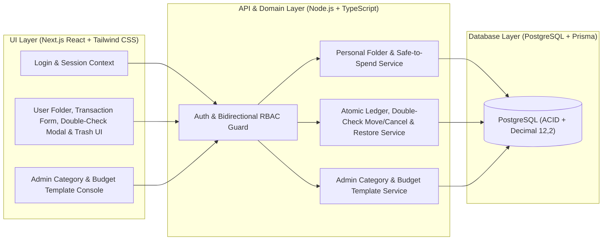
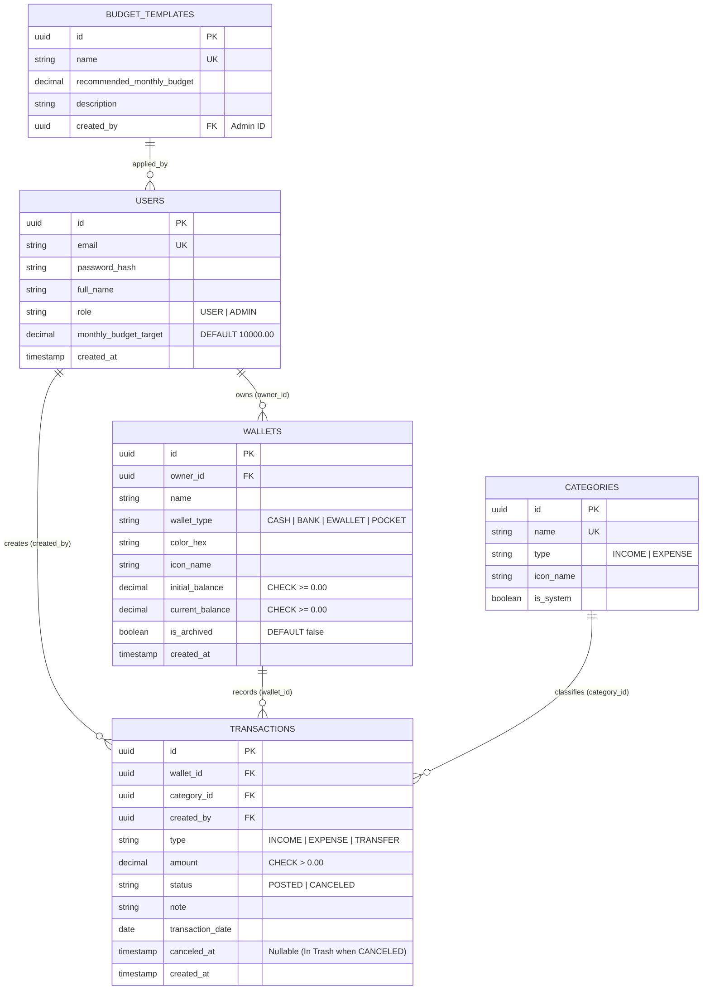

# Part C: System-Level Software Design Specification — CandyCash (`docs/system-sds.md`)

## 1. Architecture and Selected Stack
- **UI Layer:** Next.js (App Router + React + TypeScript) + Tailwind CSS
- **API / Application Layer:** Node.js + TypeScript REST API (`Route Handlers / Controllers` -> `Domain Services` -> `Prisma ORM`)
- **Database Layer:** PostgreSQL with ACID transactions (`prisma.$transaction`) and `DECIMAL(12,2)` monetary columns

## 2. Data Model & Entity-Relationship Diagram

## 3. Bidirectional Role & Permission Matrix (`USER` vs `ADMIN`)
| Endpoint / Protected Operation | Guest (No Token) | `USER` (Own Folder/Tx) | `USER` (Other User's Folder/Tx) | `ADMIN` (System Catalog & Templates) |
| :--- | :---: | :---: | :---: | :---: |
| `GET /api/categories` & `GET /api/budget-templates` | `401` | `200 OK` | N/A | `200 OK` |
| `POST /api/categories` & `POST /api/budget-templates` | `401` | `403 Forbidden` | `403 Forbidden` | `201 Created` |
| `GET /api/wallets` & `POST /api/wallets` | `401` | `200 / 201` | Not returned | `403 Forbidden` |
| `GET /api/wallets/:id/transactions` | `401` | `200 OK` | `403 Forbidden` | `403 Forbidden` |
| `POST /api/transactions` (Log Income/Expense) | `401` | `201 Created` | `403 Forbidden` | `403 Forbidden` |
| `POST /api/transactions/:id/move` (Double-Check Move) | `401` | `200 OK` (`confirmed: true`) | `403 Forbidden` | `403 Forbidden` |
| `POST /api/transactions/:id/cancel` (Double-Check Cancel) | `401` | `200 OK` (`confirmed: true`) | `403 Forbidden` | `403 Forbidden` |
| `POST /api/transactions/:id/restore` (Double-Check Restore) | `401` | `200 OK` (`confirmed: true`) | `403 Forbidden` | `403 Forbidden` |
